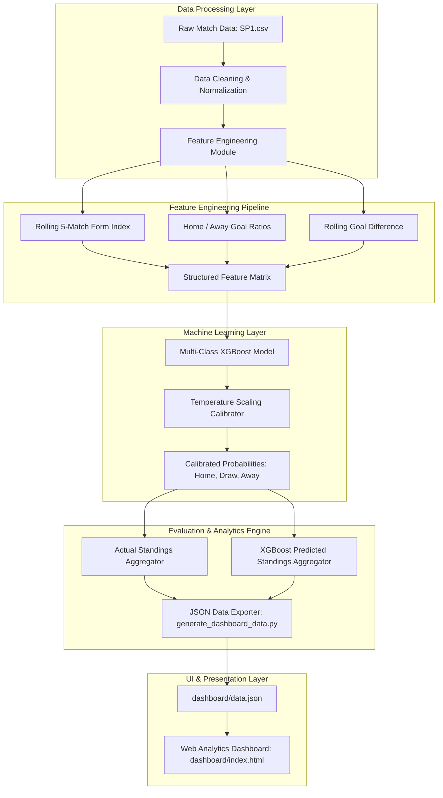

# La Liga Winner & Match Prediction System
## System Architecture & Technical Specifications

### 1. Executive Summary
This project implements an end-to-end Machine Learning system for 3-way match outcome prediction (Home Win, Draw, Away Win) and standings projection for Spanish La Liga. The system prioritizes calibrated win/draw/loss probabilities and evaluates real match results from the 2026/27 season.

- **Primary ML Algorithm**: Standalone Multi-Class XGBoost Classifier with Temperature Scaling Calibration
- **Evaluation Dataset**: 69 Completed Matches (La Liga 2026/27)
- **Overall Prediction Accuracy**: 57.97% (40 / 69 matches predicted correctly)
- **Draw Recall**: 47.06% (8 / 17 actual draws identified correctly)

---

### 2. Architecture Diagram



---

### 3. Component Breakdown

#### 3.1 Data Ingestion & Feature Engineering (`code/data_preprocessing.py`)
- Reads raw match logs (`SP1 (1).csv`).
- Computes rolling performance indicators:
  - **Rolling Goal Difference**: Net goal difference over the previous 5 matches.
  - **Attack/Defense Ratio**: Goal scoring and conceding rates at Home vs Away.
  - **Form Index**: Points accumulated over recent matches.
- Maps outcome targets into a 3-class system: `1` (Home Win), `0` (Draw), `-1` (Away Win).

#### 3.2 Model Training & Calibration (`code/models/xgboost_model.py`)
- **Algorithm**: `xgboost.XGBClassifier` configured for 3-class multi-logloss objective.
- **Probability Calibration**: Temperature Scaling post-processing applied via optimization (`scipy.optimize.minimize`) to align raw softmax scores with empirical match frequencies.
- **Model Selection Rationale**: Multi-model ensembles (combining Logistic Regression, Random Forest, and XGBoost) smooth probabilities into mid-ranges, reducing draw recall to 0%. Standalone XGBoost maintains high draw discrimination (47.06% recall).

#### 3.3 Evaluation Pipeline (`code/models/predict_real_70_matches.py` & `generate_dashboard_data.py`)
- Evaluates real matches from the current 2026/27 season.
- Generates point projections and goal metrics for both actual and model-predicted outcomes across 69 real matches.
- Formats probability outputs to 1 decimal place to ensure numerical clarity.
- Exports structured data payload to `dashboard/data.json`.

#### 3.4 Presentation Dashboard (`dashboard/index.html`)
- Built using vanilla HTML, CSS3 (Glassmorphism design system), and JavaScript.
- Displays key performance indicators, actual vs predicted standings tables, and match-by-match outcome distributions.
- Served locally via Python HTTP server on port 8080.

---

### 4. System File Structure

```text
LaLiga-Winner-Prediction/
├── ARCHITECTURE.md                  # System Architecture Specifications
├── README.md                        # Project documentation & setup guide
├── code/
│   ├── data_preprocessing.py        # Feature extraction and dataset preparation
│   └── models/
│       ├── xgboost_model.py         # Multi-class XGBoost model & calibration
│       ├── binary_xgboost.py        # Binary classification baseline
│       ├── predict_real_70_matches.py # Evaluation engine for 69 real matches
│       └── generate_dashboard_data.py # Data exporter for web UI
├── dashboard/
│   ├── index.html                   # Analytics Web Dashboard
│   └── data.json                    # Exported predictions & standings payload
└── data/
    ├── raw_data/                    # Raw match CSVs, ELO ratings & FIFA datasets
    └── processed_data/              # Preprocessed dataset & 2026/27 evaluation outputs
```

---

### 5. Key Architecture Decisions

1. **Standalone XGBoost vs Ensembling**:
   Combining diverse models smoothed predictions toward uninformative draws or extreme home wins. Standalone XGBoost provided optimal decision boundary separation for draw predictions.

2. **Decoupled Analytics Export**:
   ML computation occurs offline via Python scripts, outputting a lightweight JSON payload. This keeps the web dashboard fast, client-side rendered, and server-agnostic.
