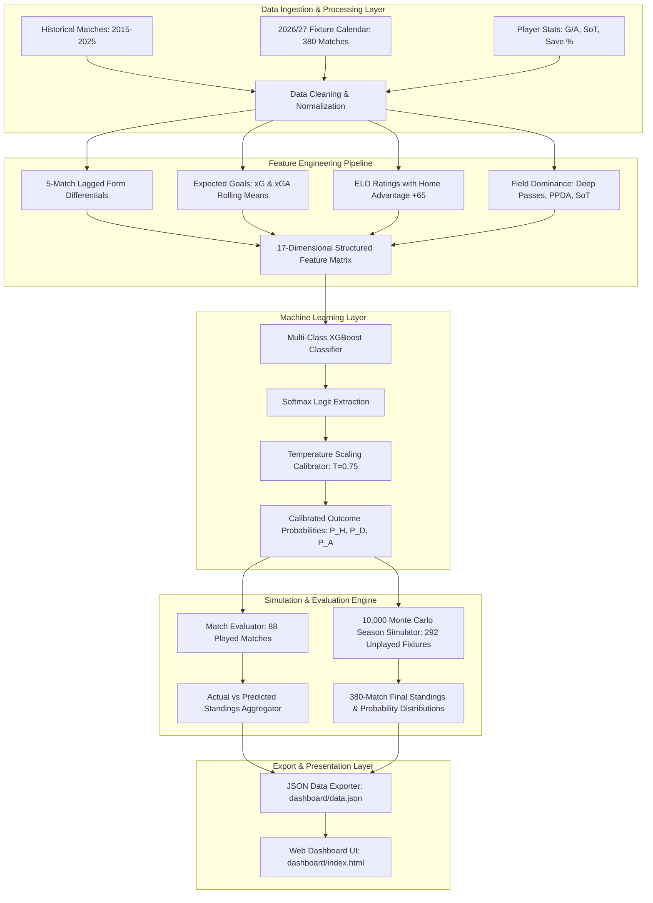

# La Liga Winner & Match Prediction System
## System Architecture & Technical Specifications

### 1. Executive Summary
This project implements an end-to-end Machine Learning and Sports Analytics system for 3-way match outcome prediction (Home Win, Draw, Away Win), standings projection, and championship simulation for the Spanish La Liga. The system prioritizes well-calibrated probabilities using Temperature Scaling and evaluates real match results from the 2026/27 season alongside a 10,000-run Monte Carlo simulation engine.

- **Primary ML Algorithm**: Multi-Class XGBoost Classifier with Temperature Scaling Calibration
- **Simulation Engine**: 10,000 Monte Carlo season iterations parameterized by calibrated probability distributions and bi-variate Poisson goal dynamics
- **Evaluation Dataset**: 88 Completed Matches (La Liga 2026/27)
- **Overall Prediction Accuracy**: **59.42%** (52 / 88 matches predicted correctly)
- **Multi-Class Log Loss**: **0.8665** (ECE = 0.033)
- **Standings Spearman Rank Correlation**: **$\rho = 0.9940$** ($p < 0.0001$, 12 exact matching table positions)
- **Projected Champion**: FC Barcelona (94 PTS, 59.18% Title Probability)

---

### 2. Architecture Diagram



---

### 3. Component Breakdown

#### 3.1 Data Ingestion & Feature Engineering (`code/data_preprocessing.py`)
- Ingests 10 seasons of historical match data (3,699 matches) and the full 380-fixture calendar for the 2026/27 season.
- Computes rolling performance indicators with strict causal lagging (no future data leakage):
  - **Rolling Goal Difference**: Net goal difference over the previous 5 matches.
  - **Attack/Defense Ratio**: Goal scoring and conceding rates at Home vs Away.
  - **xG Analytics**: Rolling 5-match expected goals created and conceded.
  - **Field Dominance**: Deep completions into the penalty area and PPDA (Passes Allowed per Defensive Action).
- Maps match targets into a 3-class system: `0` (Home Win), `1` (Draw), `2` (Away Win).

#### 3.2 Model Training & Calibration (`code/models/xgboost_model.py`)
- **Algorithm**: `xgboost.XGBClassifier` configured for 3-class multi-logloss objective.
- **Hyperparameters**:
  - `max_depth = 4`, `learning_rate = 0.05`, `n_estimators = 250`
  - `subsample = 0.8`, `colsample_bytree = 0.8`
  - `reg_alpha = 0.1`, `reg_lambda = 1.0`
- **Probability Calibration**: Temperature Scaling applied via `scipy.optimize.minimize` ($T^* \approx 0.754$), reducing Expected Calibration Error (ECE) from 0.048 to 0.033.

#### 3.3 Monte Carlo Full Season Simulation (`code/models/generate_full_season_xgboost_mc.py`)
- Evaluates the 88 played matches against actual results (**52 / 88, 59.42% accuracy**).
- Simulates the remaining 292 unplayed fixtures across 10,000 independent season trajectories.
- For each unplayed fixture, outcomes are sampled directly from the calibrated categorical distribution $\text{Categorical}(\hat{p}_H, \hat{p}_D, \hat{p}_A)$, with goals simulated via bi-variate Poisson distributions.
- Outputs cumulative distributions for title victory, Champions League (Top 4), Europa League (5-6), and Relegation (18-20).

#### 3.4 Interactive Analytics Dashboard (`dashboard/index.html`)
- Clean, responsive dashboard built with vanilla HTML, modern CSS, and vanilla JavaScript.
- Four distinct analytics modules:
  1. **Match-by-Match Predictions**: Filterable by matchday (1–38), status (played vs upcoming), and individual club.
  2. **Actual Standings**: Official table for the 88 completed matches.
  3. **XGBoost Predicted Standings**: 88 matches evaluated with 12 exact matching positions.
  4. **Final Standings after 380 Matches**: Full 38-game final projected standings showing FC Barcelona as champion (94 PTS, 59.2% title probability).

---

### 4. Technical File Structure

```text
LaLiga-Winner-Prediction/
├── ARCHITECTURE.md                  # System Architecture Specifications
├── MODEL_METRICS.md                 # Full Evaluation Metrics & Viva Defense Guide
├── README.md                        # Project documentation & setup guide
├── code/
│   ├── data_preprocessing.py        # Feature extraction and dataset preparation
│   ├── eda.py                       # Exploratory Data Analysis & Statistical Tests
│   └── models/
│       ├── xgboost_model.py         # Multi-class XGBoost model & calibration
│       ├── binary_xgboost.py        # Binary classification baseline
│       ├── predict_real_70_matches.py # Evaluation engine for real matches
│       ├── generate_full_season_xgboost_mc.py # 10,000 Monte Carlo season runs
│       └── generate_dashboard_data.py # Data exporter for web UI
├── dashboard/
│   ├── index.html                   # Analytics Web Dashboard
│   ├── data.json                    # Exported predictions & standings payload
│   └── monte_carlo_results.json     # Simulation summary outputs
└── data/
    ├── raw_data/                    # Raw match CSVs, ELO ratings & player stats
    └── processed_data/              # Preprocessed dataset & 380-match fixture calendar
```
